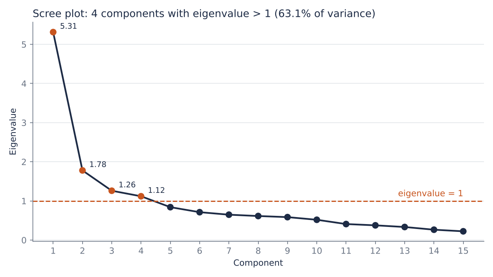
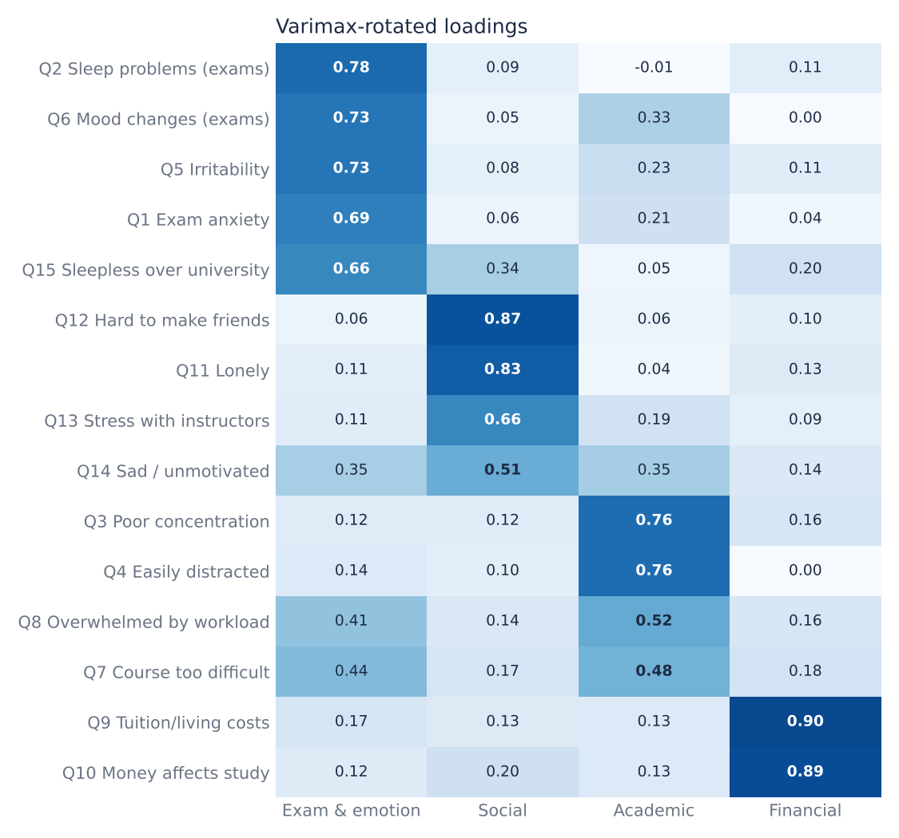
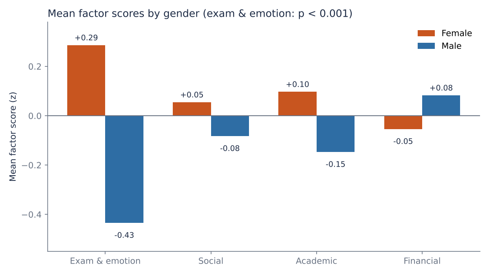

# Factor Analysis of Psychological Stress among University Students

What are the main sources of stress for university students, and do they differ by gender, year of study, or marital status?

This project applies **Exploratory Factor Analysis (EFA)** to a public survey of 610 students. It reduces 15 stress items to 4 interpretable factors, then compares factor scores across student groups.

> Team project (5 members), *Applied Multivariate Analysis* course, October 2026.
> **My role:** I wrote the R analysis, interpreted the results, and co-presented the findings.

---

## Key findings

- **4 factors explain 63.1% of the total variance:** exam & emotion (21.2%), social (16.1%), academic (13.8%), and financial (12.1%).
- **Exam & emotion is the largest source of stress.** Exam anxiety, sleep problems, and irritability cluster together, so emotional stress is tied to exam periods.
- **Female students report much higher exam & emotion stress** than male students (mean factor score +0.29 vs −0.43, Welch t = 8.93, p < 0.001).
- **The pattern differs by year of study.** First-year students report the *lowest* exam stress but the *highest* academic stress (ANOVA p = 0.001 and p = 0.015, Tukey HSD).
- **Married students report higher financial stress** than single students (+0.28 vs −0.03, p = 0.018).

| Scree plot | Rotated loadings |
|---|---|
|  |  |



---

## Data

The data is the [**Student Psychological Stress Survey Dataset (University of Anbar, Iraq), Version 2**](https://doi.org/10.17632/428whwsk6c.2) by Hussen, Ibrahim & Nafea (2026), published on Mendeley Data under CC BY 4.0: 610 respondents and 15 items on a 5-point frequency scale (1 = Never … 5 = Always). It also records gender, age, marital status, and year of study.

| File | Contents |
|---|---|
| `data/Encoded_dataset.xlsx` | 610 × 15 numeric responses (1–5) |
| `data/Raw_dataset.xlsx` | Demographics plus text responses |
| `data/Student_Stress_Questionnaire.docx` | Questionnaire wording |

**Data preparation:** The encoded file has no demographics and neither file has an ID column, so factor scores were matched to demographics by row order. Before merging, I recoded the raw text answers to 1–5 and compared them with the encoded file. All 9,150 cells (610 × 15) matched, so the rows refer to the same students.

---

## Method

1. **Descriptive statistics.** Likert items are ordinal, so I report the percentage at each response level and the median.
2. **Correlation matrix.** `rcorr`, `ggcorr`.
3. **Assumption checks.** Bartlett's test of sphericity gave p < 0.001. KMO was 0.84 ("good"), and every item had MSA > 0.5.
4. **Factor extraction.** Principal component method, `psych::principal`.
5. **Number of factors.** I compared three criteria:
   - Eigenvalue > 1 gives **4**. This is the chosen number, because a component with an eigenvalue below 1 explains less variance than a single standardized item (1/15 = 6.7%).
   - The scree plot elbow is at about 2. That solution explains only 47.3% and merges the social and financial items.
   - Cumulative variance ≥ 80% needs 8, and that solution cannot be interpreted.
6. **Rotation.** Varimax, with each factor named from items loading ≥ 0.5.
7. **Factor scores.** Regression method, standardized so the mean is 0 and the SD is 1.
8. **Group comparisons.**
   - Gender and marital status: Welch's t-test.
   - Year of study (years 1–4): one-way ANOVA with Tukey HSD, plus Welch ANOVA as a robustness check.

---

## How to run

```r
install.packages(c("readxl", "psych", "Hmisc", "GGally", "REdaS"))
# set the working directory to the repository root, then:
source("analysis/stress_fa.R")
```

---

## Repository structure

```
├── analysis/stress_fa.R      # full analysis (R)
├── data/                     # dataset + questionnaire (CC BY 4.0)
├── figures/                  # charts used in this README
└── slides/presentation.pdf   # class presentation (Thai)
```

## Limitations

- **Single source.** The data comes from one university in Iraq, so the factor structure may not generalize to other populations.
- **Exploratory only.** A follow-up Confirmatory Factor Analysis (CFA), ideally on Thai students, is needed to confirm the structure.
- **Cross-loading item.** Item Q7 (course too difficult) loads similarly on two factors (0.48 academic vs 0.44 exam & emotion).

## Data source and license

Hussen, F. M., Ibrahim, H. M., & Nafea, A. A. (2026). *Student Psychological Stress Survey Dataset (University of Anbar, Iraq)* (Version 2) [Data set]. Mendeley Data. https://doi.org/10.17632/428whwsk6c.2

Original dataset page: https://data.mendeley.com/datasets/428whwsk6c/2 (published 27 March 2026).

The dataset is licensed under [CC BY 4.0](https://creativecommons.org/licenses/by/4.0/) and is redistributed here with attribution.
