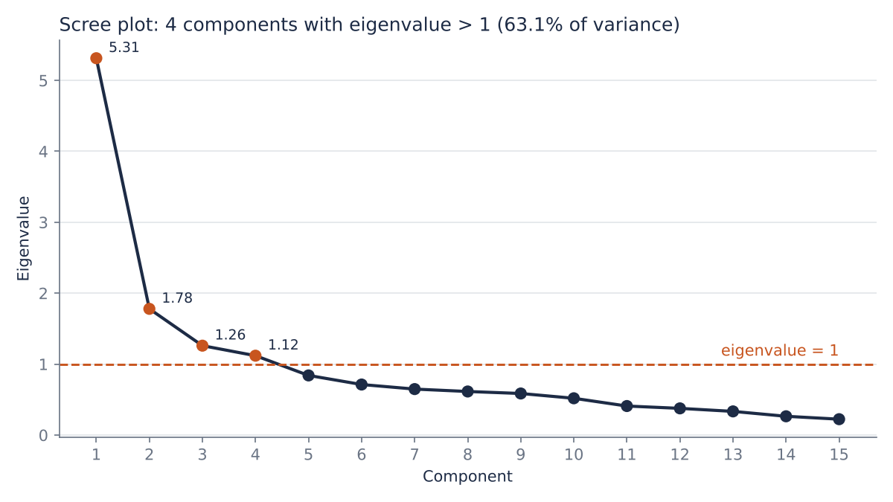
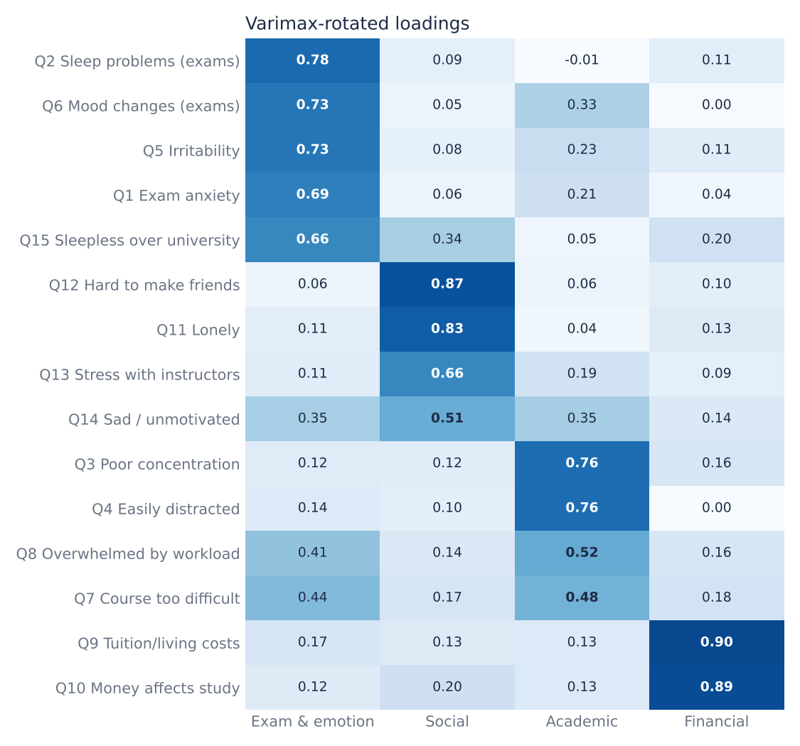
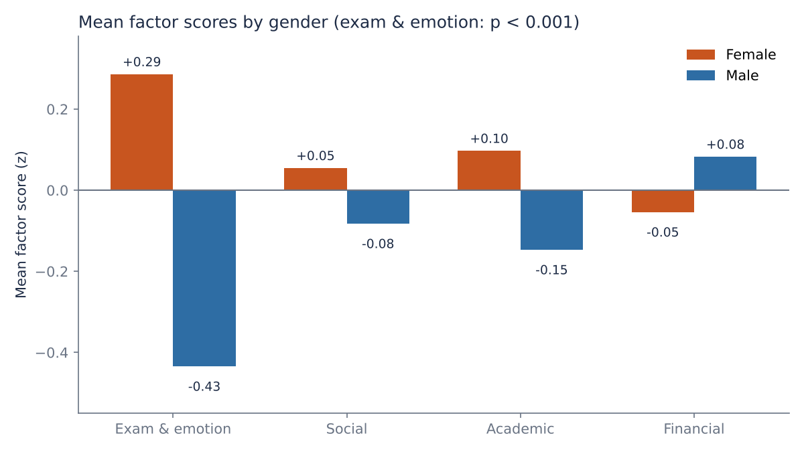

# การวิเคราะห์ปัจจัยความเครียดทางจิตใจในนักศึกษามหาวิทยาลัย

[English](README.md) | **ภาษาไทย**

นักศึกษามหาวิทยาลัยเครียดจากเรื่องอะไรบ้าง และความเครียดแต่ละด้านแตกต่างกันตามเพศ ชั้นปี หรือสถานภาพสมรสหรือไม่

โปรเจกต์นี้ใช้**การวิเคราะห์ปัจจัยเชิงสำรวจ (Exploratory Factor Analysis: EFA)** กับข้อมูลแบบสอบถามสาธารณะของนักศึกษา 610 คน ลดข้อคำถามเรื่องความเครียด 15 ข้อให้เหลือ 4 ปัจจัยที่ตีความได้ แล้วนำคะแนนปัจจัยไปเปรียบเทียบระหว่างกลุ่มนักศึกษา

> งานกลุ่ม 5 คน วิชาการวิเคราะห์หลายตัวแปรเชิงประยุกต์ ตุลาคม 2569
> **หน้าที่ของผม:** เขียนโค้ด R วิเคราะห์ข้อมูล แปลผล และร่วมนำเสนอ

---

## ผลการวิเคราะห์ที่สำคัญ

- **4 ปัจจัยอธิบายความแปรปรวนรวมได้ 63.1%** ได้แก่ การสอบและอารมณ์ (21.2%) สังคม (16.1%) การเรียน (13.8%) และการเงิน (12.1%)
- **การสอบและอารมณ์เป็นแหล่งความเครียดที่ใหญ่ที่สุด** ความกังวลเรื่องสอบ การนอนไม่หลับ และความหงุดหงิดรวมอยู่ในปัจจัยเดียวกัน แสดงว่าความเครียดทางอารมณ์ผูกอยู่กับช่วงสอบ
- **นักศึกษาหญิงเครียดด้านการสอบและอารมณ์สูงกว่าชายอย่างชัดเจน** (ค่าเฉลี่ยคะแนนปัจจัย +0.29 เทียบกับ −0.43, Welch t = 8.93, p < 0.001)
- **ชั้นปีให้รูปแบบที่ต่างกัน** นักศึกษาปี 1 เครียดเรื่องสอบ*น้อยที่สุด* แต่เครียดด้านการเรียน*มากที่สุด* (ANOVA p = 0.001 และ p = 0.015, Tukey HSD)
- **ผู้ที่สมรสแล้วเครียดด้านการเงินสูงกว่าคนโสด** (+0.28 เทียบกับ −0.03, p = 0.018)

คะแนนปัจจัยเป็นค่ามาตรฐาน ค่าเฉลี่ยของทุกคนเท่ากับ 0 ค่าบวกแปลว่าเครียดด้านนั้นมากกว่าค่าเฉลี่ย ค่าลบแปลว่าน้อยกว่าค่าเฉลี่ย

| Scree plot | ค่าถ่วงปัจจัยหลังหมุนแกน |
|---|---|
|  |  |



---

## ข้อมูล

ใช้ชุดข้อมูล [**Student Psychological Stress Survey Dataset (University of Anbar, Iraq), Version 2**](https://doi.org/10.17632/428whwsk6c.2) ของ Hussen, Ibrahim และ Nafea (2026) เผยแพร่บน Mendeley Data ภายใต้สัญญาอนุญาต CC BY 4.0 มีผู้ตอบ 610 คน ข้อคำถาม 15 ข้อ มาตรวัดความถี่ 5 ระดับ (1 = ไม่เคย … 5 = เป็นประจำ) พร้อมข้อมูลเพศ อายุ สถานภาพสมรส และชั้นปี

| ไฟล์ | เนื้อหา |
|---|---|
| `data/Raw_dataset.xlsx` | ข้อมูลส่วนบุคคล และคำตอบแบบข้อความ (ใช้เป็นหลัก) |
| `data/Encoded_dataset.xlsx` | คำตอบแบบตัวเลข (1–5) 610 แถว × 15 ข้อ ใช้ตรวจผลการแปลง |
| `data/Student_Stress_Questionnaire.docx` | ข้อคำถามทั้ง 15 ข้อ |
| `data/processed/stress_clean.csv` | ตารางที่เตรียมแล้ว: id ข้อมูลส่วนตัว Q1–Q15 (สร้างจาก notebook) |
| `data/processed/stress_with_scores.csv` | ตารางที่เตรียมแล้ว พร้อมคะแนนปัจจัย 4 ตัว (สร้างจากสคริปต์) |

### การเตรียมข้อมูล

การเตรียมข้อมูลแยกไว้ใน notebook **[`notebooks/01_data_preparation.ipynb`](notebooks/01_data_preparation.ipynb)** (Python, pandas) GitHub แสดงทุกขั้นพร้อมผลลัพธ์ เปิดอ่านตามได้เลยโดยไม่ต้องรัน

ข้อมูลที่ต้องใช้ทั้งหมดอยู่ใน**ไฟล์เดียวคือ `Raw_dataset.xlsx`** มีข้อมูลส่วนตัว 4 คอลัมน์และคำตอบ 15 ข้อแบบข้อความ notebook จะรวมเป็นตารางเดียว*ก่อน*เริ่มวิเคราะห์ ส่วนไฟล์ `Encoded_dataset.xlsx` ของผู้จัดทำใช้แค่ตรวจว่าแปลงข้อมูลถูกต้อง

| ขั้น | ทำอะไร | ผล |
|---|---|---|
| 1 | อ่านไฟล์ดิบ ตรวจขนาด ค่าว่าง และชื่อคอลัมน์ | 610 แถว × 19 คอลัมน์ ไม่มีค่าว่าง ชื่อคอลัมน์ `'Gender '` มีช่องว่างต่อท้าย |
| 2 | ตั้งชื่อคอลัมน์ใหม่ และตัดช่องว่างในข้อความ | ชื่อสั้น: `gender`, `age`, `marital`, `stage`, `Q1`–`Q15` |
| 3 | ดูคำตอบทุกแบบที่มี แล้วแปลงเป็นตัวเลข (Never = 1 … Always = 5) | มีคำตอบ 5 แบบพอดี แปลงได้ครบทุกช่อง |
| 4 | เทียบผลการแปลงกับไฟล์ Encoded ของผู้จัดทำ | ไม่ตรงกัน 0 จาก 9,150 ช่อง แปลว่าการแปลงและลำดับแถวถูกต้อง |
| 5 | เพิ่มคอลัมน์ `id` | `id` = 1 ถึง 610 |
| 6 | ตรวจแถวซ้ำ | 3 คนตอบเหมือนกันทุกข้อ แต่ข้อมูลส่วนตัวต่างกัน จึงเป็นคนละคน |
| 7 | ตรวจการตอบค่าเดียวกันทุกข้อ (straight-lining) | 5 คน (0.8%) เก็บไว้ เพราะน้อยเกินกว่าจะกระทบผล และไม่มีหลักฐานว่าตอบไม่ตั้งใจ บันทึกเป็นข้อจำกัด |
| 8 | ตรวจขนาดกลุ่ม | หญิง 368 / ชาย 242, โสด 547 / สมรส 63, ปี 1–4 รวม 603 คน (ป.โท 6 คน และ ป.เอก 1 คน ตัดออกเฉพาะตอนเปรียบเทียบชั้นปี) |
| 9 | บันทึกไฟล์ แล้วอ่านกลับมาตรวจ | `data/processed/stress_clean.csv`: 610 แถว × 20 คอลัมน์ |

สคริปต์ R อ่าน `stress_clean.csv` วิเคราะห์ปัจจัยจากคอลัมน์ Q1–Q15 แล้วเติมคะแนนปัจจัย 4 ตัวเป็นคอลัมน์ใหม่ในตารางเดิม (`stress_with_scores.csv`) คะแนนของแต่ละคนจึงอยู่ในแถวของคนนั้นเสมอ

ตัวอย่าง: นักศึกษาคนแรก

| ขั้น | id | เพศ | อายุ | สถานภาพ | ชั้นปี | คำตอบ / คะแนนปัจจัย |
|---|---|---|---|---|---|---|
| ไฟล์ดิบ | – | Female | 24 | Single | Stage 4 | Always, Always, Sometimes, Sometimes, … |
| `stress_clean.csv` | 1 | Female | 24 | Single | Stage 4 | Q1–Q4 = 5, 5, 3, 3, … |
| `stress_with_scores.csv` | 1 | Female | 24 | Single | Stage 4 | การสอบและอารมณ์ **+1.51** · สังคม **+1.14** · การเรียน **−1.20** · การเงิน **+1.19** |

---

## ขั้นตอนการวิเคราะห์

1. **สถิติพรรณนา:** ข้อมูล Likert เป็นมาตราเรียงลำดับ จึงรายงานร้อยละของแต่ละระดับคำตอบและมัธยฐานแทนค่าเฉลี่ย
2. **เมทริกซ์สหสัมพันธ์:** ใช้ `rcorr` และ `ggcorr`
3. **ตรวจสอบข้อตกลงเบื้องต้น:** Bartlett's test of sphericity ได้ p < 0.001 ค่า KMO = 0.84 (ระดับดี) และค่า MSA รายข้อเกิน 0.5 ทุกข้อ
4. **สกัดปัจจัย:** ใช้วิธีส่วนประกอบหลัก (`psych::principal`)
5. **กำหนดจำนวนปัจจัย:** เทียบ 3 เกณฑ์
   - ค่าเฉพาะมากกว่า 1 ได้ **4 ปัจจัย** และเลือกใช้เกณฑ์นี้ เพราะปัจจัยที่ค่าเฉพาะต่ำกว่า 1 อธิบายความแปรปรวนได้น้อยกว่าข้อคำถามเดิมเพียงข้อเดียว (1/15 = 6.7%)
   - Scree plot หักศอกที่ประมาณ 2 ปัจจัย แต่อธิบายได้แค่ 47.3% และรวมข้อเรื่องสังคมกับการเงินไว้ด้วยกัน
   - ร้อยละความแปรปรวนสะสมอย่างน้อย 80% ต้องใช้ 8 ปัจจัย ซึ่งตีความไม่ได้
6. **หมุนแกน:** ใช้วิธี Varimax แล้วตั้งชื่อปัจจัยจากข้อที่มีค่าถ่วงตั้งแต่ 0.5 ขึ้นไป
7. **คะแนนปัจจัย:** คำนวณด้วยวิธีถดถอย (regression) เป็นค่ามาตรฐาน ค่าเฉลี่ย 0 ส่วนเบี่ยงเบนมาตรฐาน 1
8. **เปรียบเทียบระหว่างกลุ่ม:**
   - เพศและสถานภาพสมรส: Welch's t-test
   - ชั้นปี (ปี 1–4): One-way ANOVA ตามด้วย Tukey HSD และตรวจซ้ำด้วย Welch ANOVA

---

## วิธีรันโค้ด

**1. เตรียมข้อมูล (Python)**

```bash
pip install pandas openpyxl jupyter
cd notebooks
jupyter notebook 01_data_preparation.ipynb   # กด Run All
```

**2. วิเคราะห์และสร้างกราฟ (R)** รันจากโฟลเดอร์หลักของโปรเจกต์

```r
install.packages(c("psych", "Hmisc", "GGally", "REdaS", "ggplot2"))
source("analysis/stress_fa.R")
```

---

## โครงสร้างโฟลเดอร์

```
├── notebooks/01_data_preparation.ipynb   # เตรียมข้อมูล (Python)
├── analysis/stress_fa.R      # วิเคราะห์ปัจจัย เปรียบเทียบกลุ่ม และสร้างกราฟ (R)
├── data/                     # ชุดข้อมูลต้นฉบับและแบบสอบถาม (CC BY 4.0)
│   └── processed/            # ข้อมูลที่เตรียมแล้ว (สร้างจาก notebook และสคริปต์)
├── figures/                  # กราฟที่ใช้ใน README
└── slides/presentation.pdf   # สไลด์นำเสนอในชั้นเรียน
```

## ข้อจำกัด

- **ข้อมูลมาจากแหล่งเดียว:** เก็บจากมหาวิทยาลัยแห่งเดียวในอิรัก โครงสร้างปัจจัยจึงอาจใช้กับนักศึกษากลุ่มอื่นไม่ได้
- **เป็นการวิเคราะห์เชิงสำรวจเท่านั้น:** ควรยืนยันโครงสร้างด้วยการวิเคราะห์ปัจจัยเชิงยืนยัน (CFA) ต่อ โดยเฉพาะกับนักศึกษาไทย
- **มีผู้ตอบค่าเดียวกันทุกข้อ:** 5 คน (0.8%) ตอบเหมือนกันทั้ง 15 ข้อ เก็บไว้ในการวิเคราะห์ แต่ถ้าลองตัดออกแล้ววิเคราะห์ซ้ำ (sensitivity analysis) จะทำให้ผลน่าเชื่อถือขึ้น
- **มีข้อคำถามที่โหลดสองปัจจัย:** ข้อ Q7 (หลักสูตรยากเกินไป) มีค่าถ่วงใกล้กันระหว่างปัจจัยการเรียน (0.48) และการสอบและอารมณ์ (0.44)

## แหล่งที่มาของข้อมูล

Hussen, F. M., Ibrahim, H. M., & Nafea, A. A. (2026). *Student Psychological Stress Survey Dataset (University of Anbar, Iraq)* (Version 2) [Data set]. Mendeley Data. https://doi.org/10.17632/428whwsk6c.2

หน้าชุดข้อมูลต้นทาง: https://data.mendeley.com/datasets/428whwsk6c/2 (เผยแพร่ 27 มีนาคม 2026)

ชุดข้อมูลใช้สัญญาอนุญาต [CC BY 4.0](https://creativecommons.org/licenses/by/4.0/) และนำมาเผยแพร่ต่อในที่นี้พร้อมให้เครดิตผู้จัดทำ
